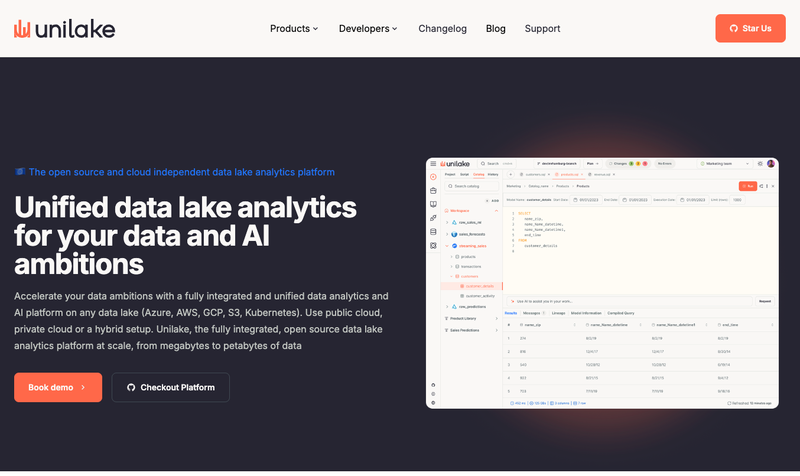
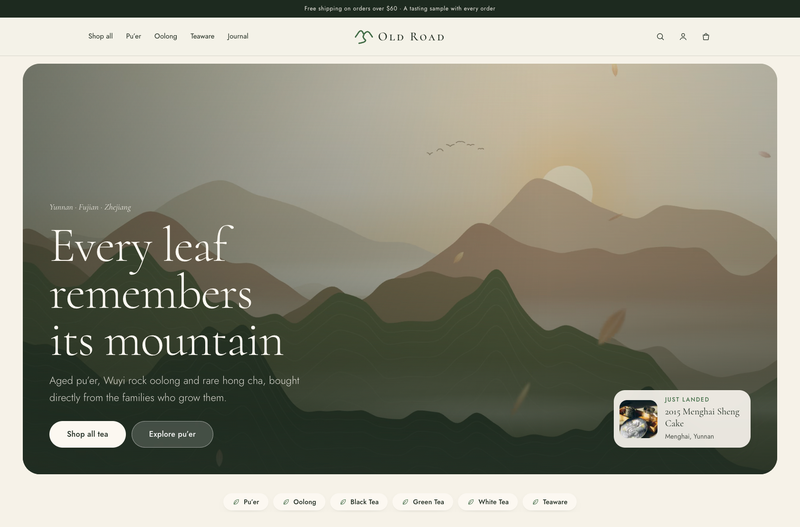

  

  3+ years building Next.js web apps for SaaS, e-commerce and education products, from the API and database to a polished, pixel-perfect UI.
   
  20+ websites and web apps shipped as a Top Rated freelancer on Upwork, 100% Job Success Score across 26 contracts.
    
  
  
  

---

### 💼 Projects

**[Art Opening Minds](https://artopeningminds.org/)** — social-emotional learning platform used by UC Riverside, College of Marin and other US colleges.\
Built a big chunk of the frontend: curriculum search, instructor dashboards, the student class flow and custom Clerk auth pages. Connected it to a Xano backend through REST APIs and Next.js Server Actions; unit tests with Jest and React Testing Library.\
`Next.js` `React` `TypeScript` `Tailwind CSS` `Clerk` `REST APIs`

**[Unilake](https://www.unilake.com/)** — open-source data analytics platform.\
Built the marketing site and [docs site](https://docs.unilake.com/) on shared UI components, with Sentry error monitoring.\
`Tailwind CSS` `JavaScript` `Sentry` `Docker`

**[Old Road](https://tea-shop-coral.vercel.app/)** — full-stack e-commerce store for Chinese tea\
Next.js app built end to end: product collections, search, cart, Stripe Checkout, authentication and user accounts. Stock reservation that holds up when several people buy at once, idempotent webhooks and an admin dashboard. · [code](https://github.com/yeldynov/tea-shop)\
`Next.js` `TypeScript` `PostgreSQL` `Drizzle` `Stripe` `Better Auth` `Tailwind CSS`

**Other**
- [Roam](https://github.com/yeldynov/roam) — Airbnb-style mobile app where you search for stays in plain English · `React Native` `Expo` `TypeScript` `NativeWind` `Sanity` `Clerk` `PostHog`
- [Vertex](https://vertex-delta-orpin.vercel.app/) — video learning platform with AI search that opens lessons at the exact second a topic is taught · [code](https://github.com/yeldynov/vertex) · `Next.js` `TypeScript` `Gemini` `Sanity` `Clerk` `Zod`
- [Atelier](https://atelie-store-beta.vercel.app/) — luxury fashion storefront with collections, cart and Stripe Checkout · [code](https://github.com/yeldynov/atelie-store) · `Next.js` `TypeScript` `PostgreSQL` `Drizzle` `Better Auth` `Stripe`
- [CarePulse](https://carepulse-tau-one.vercel.app/) — health care app for patient registration and appointments · `Next.js` `Appwrite` `shadcn/ui`
- [Gvozdi](https://gvozdi-pwa.netlify.app/) — offline-first PWA for nail board practice · `React` `IndexedDB` `Zustand` `Clerk`
- [Photographer portfolio](https://wondrous-lolly-081cc0.netlify.app/) — portfolio site with a photo gallery · `React` `Framer Motion`
- [AI Startup](https://ai-startup-lp.netlify.app/) — landing page for an AI-powered photo search product · `React` `Tailwind CSS`
- [EVO Gym](https://gleeful-lebkuchen-0c1740.netlify.app/) — landing page for a fitness gym · `React` `TypeScript` `Framer Motion`
---
### 🛠️ Stack

**Core**

  
  
  
  
  
  
  
  
  
  

**Backend, data & auth**

  
  
  
  
  
  
  

**Mobile, AI & analytics**

  
  
  
  
  

**Testing & delivery**

  
  
  
  
  
  

**Also used**

  
  
  
  
  
  
  
  
  
  
  
  
  
  
  
  
  

**Practices**

  
  
  
  
  
  
  
  
  

  

